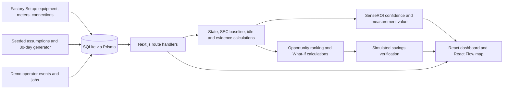

# FactoryPulse

**Find the waste. Prove the fix. Scale what works.**

FactoryPulse is a production-aware, confidence-aware industrial energy decision prototype for brownfield manufacturing SMEs. It connects energy use to machine state, good output, operator context, investment choices, and post-action verification.

Built by **Team Code Storm** for **Schneider Electric Yuva Yodha 2026**.

> **Prototype & data disclaimer:** Pragati AutoFab Pvt. Ltd., Nashik is a fictional factory. Its telemetry, jobs, events, opportunities, confidence scores, and verified-savings example are **demo / simulated data**. The app has no live meter feed or deployed plant integration.

## The problem and the decision loop

An electricity bill or a partially metered feeder tells a factory how much it consumed, but rarely which idle period was avoidable, whether output changed, whether a retrofit will pay back, or which missing measurement would resolve uncertainty. The barrier is uncertainty before adoption.

FactoryPulse follows **Find → Explain → Simulate → Decide → Verify → Learn**. It combines electrical topology, five-minute energy samples, production jobs, operator events, contextual baselines, manager constraints, and outcome verification. It is a decision layer rather than only a consumption dashboard.

## Explore the prototype

| Screen | What it does |
| --- | --- |
| **Overview** | Shows simulated live demand, energy cost, factory SEC, best action, opportunity value, verified result, and a guided nine-step demo. |
| **Live Energy Map** | Draws the configured electrical hierarchy with React Flow; shows inferred/direct-meter coverage and parent energy that remains unattributed. |
| **Loss Detective** | Compares energy against production-normalized healthy baselines and interprets machine states and idle evidence. |
| **Operator Insights** | Captures shop-floor reasons and changes a generic idle diagnosis into a specific operational cause and recommendation. |
| **Opportunities** | Scores a small intervention library against editable CAPEX, payback, production, quality, and risk guardrails. |
| **What-If Lab** | Recalculates deterministic idle, standby, replacement, compressor, and coating scenarios as inputs change. |
| **SenseROI** | Identifies a targeted temporary measurement when evidence is weak, instead of forcing an equipment purchase. |
| **Verification** | Compares before/after LC-01 energy per good job and records the reasoning and result in an Energy Decision Passport. |
| **Factory Setup** | Edits factory areas, equipment, electrical/process connections, meters, sensors, and explicit metering coverage. |
| **Operator Logs** | Shows generated production jobs. |

**Energy Audit, Reports, and Settings are UI placeholders**, not completed analytical modules.

### SenseROI: measure what matters, not everything

In the **demo / simulated scenario**, PC-01 is covered by a shared feeder. SenseROI recommends a seven-day temporary branch measurement costing an illustrative ₹12,000. Its transparent demo score estimates confidence rising from **57% to 89%**. The number expresses assumed information gain, not a field-validated probability or saving. The prototype does not provision a sensor.

### LC-01: the presentation story

The deterministic `LC01_EXCESS_IDLE_MATERIAL_WAIT` scenario shows a directly metered laser cutter leaving productive load and remaining near **9.8 kW** while idle. The model compares **2.4 h/day** observed idle with a **0.9 h/day** healthy baseline. An operator `MATERIAL_WAIT` event points toward staging sheets before the current job finishes. The decision engine ranks material staging/job sequencing ahead of a machine replacement; the What-If Lab and simulated verification then test that choice. This is a repeatable workflow demonstration, **not measured data from Nexstep or another factory**.

## Architecture: implemented prototype



The generator writes **30 days of five-minute simulated readings** and jobs to SQLite. The first 14 days provide healthy baseline candidates; later days contain seeded operational problems. A simulated clock updates the map every four browser seconds. The LC-01 presentation scenario is fixed in the simulation layer so real browser time cannot turn it off. Factory Setup changes persist locally in SQLite; manager constraints and guided-demo state live in the browser. No cloud service, live OT adapter, LLM runtime, or autonomous plant control is implemented.

**Potential production architecture, not implemented here:** authorized PowerLogic/PowerTag and PLC data could enter through site-approved gateways or APIs; MES/ERP/CSV could supply jobs and output. Protocol selection, cybersecurity, permissions, calibration, and site/OEM validation would be deployment work. An LLM could orchestrate tools and explain results while deterministic models retain responsibility for energy, ROI, and verification arithmetic.

### Core calculations

| Quantity | Prototype rule |
| --- | --- |
| Energy | `kWh = kW × hours` |
| Specific energy consumption | `SEC = energy kWh / good output` |
| Expected energy | `median SEC of comparable healthy jobs × current good output` |
| Residual | `actual kWh − expected kWh` |
| Candidate avoidable idle energy | `max(0, observed idle h − healthy idle h) × average idle kW`, capped by classified intervals |
| Financial saving | `estimated avoided kWh × assumed tariff` |
| Simple payback | `CAPEX / annual financial saving × 12 months` |
| Verified saving | `before SEC × after good output − after energy` |

Comparable baselines consider equipment, product, shift, batch size, and duration. A positive residual alone is not labeled waste; repeated evidence and context matter. Production-normalized verification keeps reduced output from masquerading as an energy saving. The example after-period is generated in memory, so its “verified” label means **verified within the simulation**, not a real field result. See [formulas](docs/FORMULAS.md) and [judge Q&A](docs/JUDGE_QA.md).

## Getting started

**Prerequisites:** Node.js 20.9+ and npm. The database is a local SQLite file; no API key is needed.

```bash
git clone https://github.com/SwarajPatil2318/Factory_pulse_code_storm.git
cd Factory_pulse_code_storm
npm ci
cp .env.example .env
npm run db:generate
npm run db:push
npm run sim:generate
npm run dev
```

Open **http://localhost:3000** and select **Run Demo** on Overview. The example `.env` uses `DATABASE_URL="file:./dev.db"`, which Prisma resolves to `prisma/dev.db`. That database is generated locally and ignored by Git. To reset the generated historical period, run `npm run sim:generate -- --replace`. The interface marks simulated values as such; nothing is read from real factory equipment.

Useful checks: `npm run typecheck`, `npm test`, and `npm run build`. There is no lint script in this repository.

## Tech stack

| Layer | Implemented technology |
| --- | --- |
| UI | Next.js 16 App Router, React 19, TypeScript, Tailwind CSS 4, Radix-based UI components |
| API | Next.js route handlers, Zod validation |
| Storage | Prisma 6 and local SQLite |
| Visualization | React Flow, Recharts |
| Browser state | Zustand |
| Analytics | TypeScript deterministic simulation, statistical baselines, evidence rules, ROI/What-If and verification calculations |
| AI | No LLM/API integration in the runnable prototype |

## Repository map

```text
data/                    Demo assumptions and intervention library
docs/                    Formula audit, demo script, judge Q&A
prisma/schema.prisma     SQLite data model
scripts/                 Historical simulation generator
src/app/                 Next.js pages and API routes
src/components/          Screens, charts, map, and shared UI
src/lib/                 Simulation and decision calculations with tests
src/store/               Browser workspace state
```

## Brownfield fit and ecosystem alignment

FactoryPulse explicitly models direct meters, shared feeder meters, inferred loads, and unmetered equipment. It uses available job records and operator knowledge before suggesting more instrumentation or CAPEX. **Adapt the system to the factory, not the factory to the software.**

### Schneider Electric Ecosystem Alignment

**Conceptual integration only:** PowerLogic/PowerTag could provide electrical measurements; Panel Server or Power Monitoring Expert could aggregate them; Modicon PLCs could supply machine context; Altivar drives could execute justified control changes. The intended loop is **Schneider senses → FactoryPulse decides → Schneider executes → FactoryPulse verifies**. This repository demonstrates none of those hardware integrations and does not imply certification or partnership.

### Field research

Team Code Storm visited **Nexstep Multiparking, Nashik** to understand manufacturing energy challenges. Discussions about electricity bills, intermittent fabrication loads, idle/standby windows, and instrumentation uncertainty informed the problem framing and prototype workflow. Nexstep does **not** use this prototype as a deployed pilot, and this repository makes no claim of quantified Nexstep savings or validated ROI.

## Prototype & Data Disclaimer

All factory telemetry and decision outcomes in the runnable demo are deterministic simulations. Intervention percentages, financial opportunities, confidence values, and post-intervention comparisons are illustrative and require site, OEM, utility-tariff, and measurement validation before any real purchase or operating change. The Nexstep visit was problem discovery, not field validation of savings.

## Demo and team

[Watch FactoryPulse in Action](ADD_FINAL_VIDEO_LINK_HERE) · [Four-minute demo script](docs/DEMO_SCRIPT.md)

### Team Code Storm

**Swaraj Patil — Frontend & Backend Development**

Full-stack prototype development, application logic, dashboard implementation, backend/API integration, and product implementation.

Strengths: Full-Stack Engineering · Backend APIs · Frontend Development · Product Implementation.

LinkedIn: _add link_ · GitHub: _add link_

**Rutika Shripati — System Design & AI Integration**

System architecture, AI workflow integration, data-flow design, and decision-engine orchestration. The runnable prototype currently uses deterministic logic rather than a live AI service.

Strengths: System Design · AI Integration · Data Architecture · Intelligent Workflow Design.

LinkedIn: _add link_ · GitHub: _add link_

No software license is granted in this repository at present.
